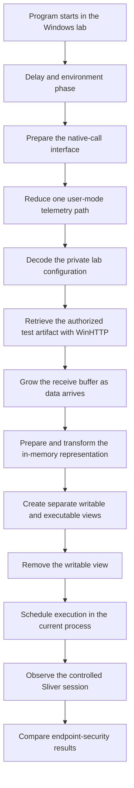
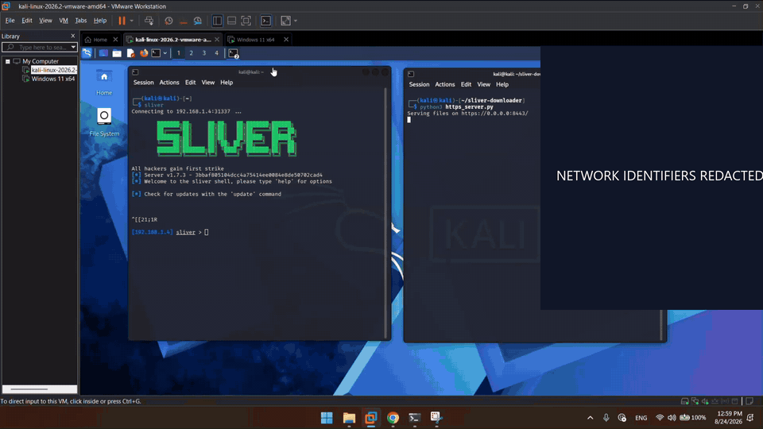
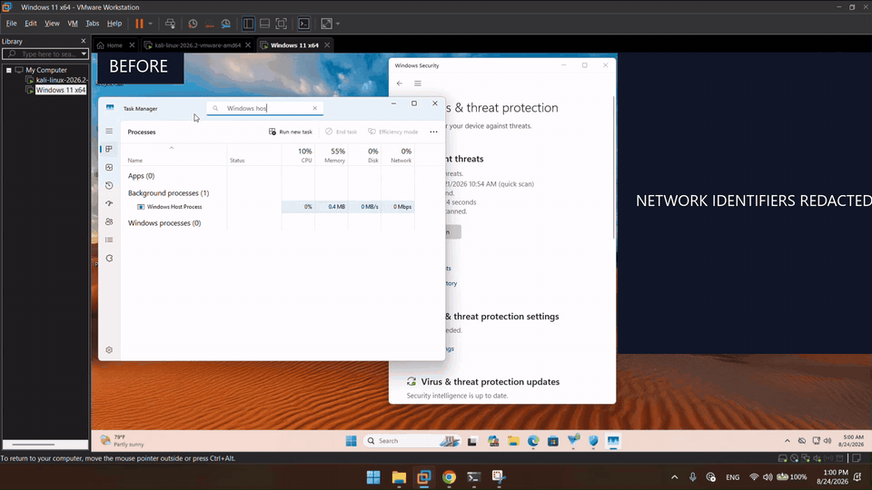
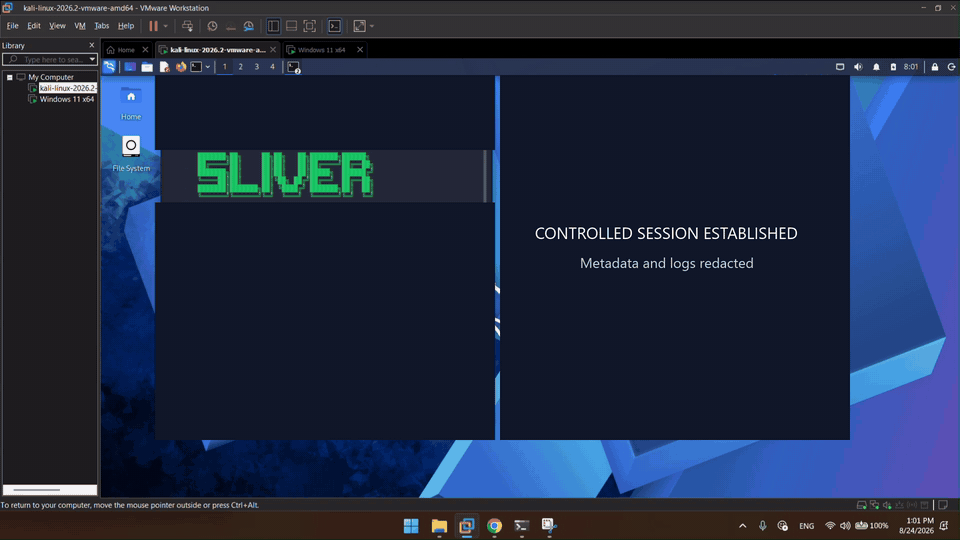
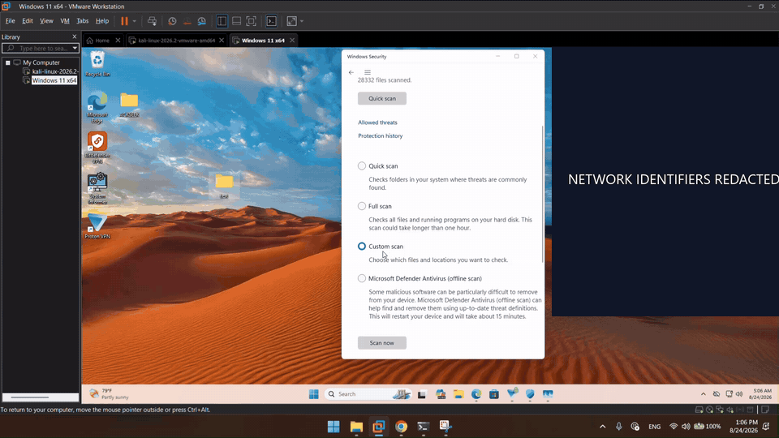

<p align="center">
  
</p>

<h3 align="center">Windows in-memory execution and endpoint-visibility research</h3>

<p align="center">
  A controlled internship project examining what endpoint-security products can still observe<br>
  after static, telemetry, native-interface, memory, and execution indicators are reduced.
</p>

<p align="center">
  
  
  
  
  
  
  
  
</p>

<p align="center">
  <a href="#echoseek-in-one-minute">Overview</a> ·
  <a href="#complete-execution-flow">Architecture</a> ·
  <a href="#evasion-and-visibility-layers">Evaluation layers</a> ·
  <a href="#authentic-public-code">Authentic code</a> ·
  <a href="#step-by-step-test-evidence">Test evidence</a>
</p>

---

ECHOSEEK is a private C++ research prototype developed during my cybersecurity engineering internship at ACKSEEK from 15 June to 1 September 2026. It studies how a Windows in-memory execution chain appears to antivirus and endpoint detection products at several different layers.

The complete implementation is not public because the combined project is an operational loader. This repository explains the complete design and results, publishes sanitized proof, and includes only one small authentic source excerpt from my original code.

## ECHOSEEK in one minute

| Question | Answer |
|---|---|
| What is it? | A Windows research loader used in an isolated lab with an authorized Sliver test artifact |
| What was the goal? | Study which indicators remain visible across files, telemetry, native calls, process memory, execution history, and behavior |
| What did I build? | Configuration decoding, WinHTTP retrieval, dynamic buffering, native-call resolution, telemetry modification, section-backed memory views, in-memory transformation, and asynchronous dispatch |
| What worked? | The documented Defender, Malwarebytes, and selected Bitdefender static or memory-oriented checks did not alert in the tested configuration |
| What failed? | Bitdefender Advanced Threat Defense detected the runtime behavior |
| What is public? | Architecture, full conceptual flow, evasion-layer analysis, sanitized evidence, and one unchanged helper from the original source |

The important conclusion is not that ECHOSEEK is “undetectable.” It is that hiding individual indicators is different from hiding the history of how execution reached a sensitive operation.

## Project structure

The private project has three main code areas:

| Private component | Responsibility | Public status |
|---|---|---|
| `implant.cpp` | Coordinates startup delay, configuration recovery, network retrieval, buffer management, memory preparation, dispatch, and cleanup | One small transformation helper is public |
| `syscalls.cpp` / `syscalls.h` | Resolves the native operations needed by the prototype and prepares the low-level call interface | Design explained; implementation withheld |
| `etw.cpp` / `etw.h` | Changes a user-mode telemetry path for the controlled experiment | Design explained; implementation withheld |

## Complete execution flow



### 1. Startup and timing

The program begins with a deliberate delay. This was used to study a simple sandbox limitation: short automated analysis windows may stop observing before delayed activity begins. A delay alone is not reliable evasion and is easy for mature analysis systems to recognize or accelerate.

### 2. Native-call preparation

The private `syscalls` component locates the native operations required for section creation, view mapping, and view removal. The experiment included a Halo's Gate-style neighboring-stub search and a fallback reader, then created a small local call interface.

Why this mattered: many products observe conventional user-mode API paths. Moving closer to the operating-system boundary changes which user-mode hooks see the request, but it does not make the kernel operation or its consequences invisible.

The resolver, identifiers, generated stubs, byte patterns, and exact call sequence are not published.

### 3. User-mode telemetry experiment

The private `etw` component changed the user-mode Event Tracing for Windows write path used in the experiment. ETW is a Windows event infrastructure used by the operating system and security products. The purpose was to measure what happened when one user-mode source produced less telemetry.

This did not disable every form of monitoring. Kernel visibility, memory inspection, call-stack analysis, and behavioral correlation remained available. The modification code and patch bytes are withheld.

### 4. Configuration and network retrieval

The lab endpoint was stored in an encoded form and recovered at runtime. WinHTTP then parsed the URL, opened the authorized HTTPS connection, and received the controlled test artifact in blocks.

The receive buffer began with reserved capacity and expanded when another block would exceed the current allocation. Network identifiers, encoded bytes, key material, request settings, and infrastructure configuration are not public.

### 5. In-memory preparation

The received data was converted into the internal representation expected by the prototype and transformed in memory. A small MZ-like wrapper was part of this experiment, allowing the project to study how recognizable structure and memory content influence scanning.

The wrapper layout, offsets, artifact format, and complete transformation sequence remain private.

### 6. Section-backed memory lifecycle

Instead of treating one private allocation as writable and executable at the same time, the prototype used a section-backed design with separate views:

- a writable view for copying and preparation;
- an executable view for the later controlled transfer;
- removal of the writable view before dispatch.

Both views referred to the same underlying section. This made memory type, permission history, and view lifetime part of the evaluation. The exact native calls, flags, and ordering code are withheld.

### 7. Asynchronous dispatch

The final transfer was scheduled through an asynchronous Windows mechanism on the current thread, followed by an alertable state in which the scheduled routine could run. This avoided creating a new worker thread, but it did not remove behavioral evidence such as instruction-pointer history, call-stack provenance, or process context.

The dispatch API sequence and executable offset are not published.

### 8. Controlled validation

The resulting session was observed in an isolated Sliver lab. Windows Security state, process behavior, memory changes, and product reactions were recorded. No persistence, lateral movement, credential access, or activity outside the authorized lab was part of this evaluation.

## Evasion and visibility layers

| Layer | Technique evaluated | What it attempted to change | Result in the documented lab |
|---:|---|---|---|
| 1 | Runtime string decoding and altered in-memory representation | Readable strings and recognizable static content | No alert in the captured Defender custom scan |
| 2 | Delayed startup | Short sandbox observation windows | The controlled run reached its intended runtime phase |
| 3 | User-mode telemetry modification | One ETW event path | Reduced that user-mode signal; other visibility remained |
| 4 | Native-call resolution | Exposure to conventional API hooks | Required native operations completed in the lab |
| 5 | Section-backed writable and executable views | Allocation type and permission-transition indicators | Tested memory-oriented checks did not alert in the recorded configuration |
| 6 | Asynchronous current-thread dispatch | New-thread indicators | The controlled session reached its expected state |
| 7 | Behavioral correlation | The complete execution story | Bitdefender Advanced Threat Defense detected the runtime behavior |

The detailed defensive interpretation is available in [TECHNICAL-NOTES.md](TECHNICAL-NOTES.md).

## Authentic public code

The [`public-code`](public-code/) directory now contains only a genuine excerpt from the original private project. It does not contain a rewritten demonstration or code created for this repository.

[`source_excerpt.cpp`](public-code/source_excerpt.cpp) publishes the original in-place byte transformation helper:

```cpp
void XorMemory(PVOID base, SIZE_T size, BYTE* key, DWORD keyLen) {
    BYTE* p = (BYTE*)base;
    for (SIZE_T i = 0; i < size; i++) {
        p[i] ^= key[i % keyLen];
    }
}
```

How it works:

1. `base` points to the first byte of a memory region.
2. The pointer is treated as a byte array.
3. The loop visits exactly `size` bytes.
4. `i % keyLen` repeats the key when the region is longer than the key.
5. XOR changes each byte in place. Applying the same key a second time restores the original value.

This is simple reversible obfuscation, not encryption. In the private program it was only one helper inside a larger memory lifecycle. The original caller supplied a non-empty key; a reusable production interface should validate that `keyLen` is not zero.

## Technology and lab stack

| Technology | Role |
|---|---|
| C++ and Windows SDK | Private systems implementation and Windows interface research |
| Windows 11 x64 | Isolated endpoint under evaluation |
| Kali Linux | Separate authorized lab infrastructure |
| VMware Workstation | Reproducible virtual-machine boundary |
| [Sliver](https://github.com/BishopFox/sliver) | Authorized adversary-emulation framework used for the controlled session |
| Microsoft Defender | Primary Windows endpoint-protection evaluation |
| Malwarebytes | Secondary real-time and heuristic evaluation |
| Bitdefender | Static, memory-oriented, and advanced behavioral evaluation |

Product names and logos identify the documented test environment and do not imply endorsement.

## Step-by-step test evidence

The proof is split into four short GIFs so the sequence is understandable without downloading a file. Every GIF preserves the complete 16:9 VMware frame. Nothing is zoomed or cropped; opaque labeled panels cover only network identifiers, session metadata, and logs that should not be public.

### Step 1 — Establish the baseline

Windows Security is reviewed before the controlled execution phase. The sequence records the initial protection state and the Defender configuration visible in the test environment.

<p align="center">
  
</p>

**What this supports:** the endpoint was observable and Windows Security reported no current threat at the recorded baseline. It does not show what happens during execution.

### Step 2 — Observe the memory transition

Task Manager is filtered to the expected Windows host process. The GIF deliberately joins two moments from the same run: approximately **0.4 MB before** the runtime phase and approximately **109.8 MB after** it.

<p align="center">
  
</p>

**What this supports:** the expected process remained active and its memory footprint changed during the test. The observation is consistent with the documented in-memory path, but Task Manager alone cannot prove the private internal mechanism.

### Step 3 — Confirm the controlled session

The isolated Linux system reaches the expected Sliver session state, confirming that the complete lab path executed end to end. The framework identity remains visible while addresses, host data, usernames, session identifiers, hashes, and operational logs are covered.

<p align="center">
  
</p>

**What this supports:** the authorized test session was established. It intentionally does not expose the infrastructure or reproduce the operational procedure.

### Step 4 — Perform the post-run Defender check

The final sequence returns to Windows Security, selects the test location, and records the custom-scan result after the controlled run.

<p align="center">
  
</p>

**What this supports:** the recorded custom scan completed without reporting a threat and Windows Security displayed no action required at that moment. It is a time-bounded lab observation, not a universal or durable bypass claim.

For reviewers who want the uninterrupted sequence, the repository also includes the [complete 114-second H.264 recording](assets/demo/echoseek-lab-validation-redacted.mp4). The public cut is silent and excludes private infrastructure and operational details.

### Result matrix

| Evaluation | Documented observation | Evidence available here |
|---|---|---|
| Microsoft Defender custom scan | No threat reported in the captured snapshot | Step 4 GIF and complete recording |
| Windows Security after execution | No action required in the captured run | Step 4 GIF and complete recording |
| Runtime process observation | Expected host process remained active with the documented memory transition | Step 2 GIF and complete recording |
| Controlled Sliver path | Session reached its expected state | Step 3 GIF with metadata redacted |
| Malwarebytes | No alert in the tested configuration | Private engineering report |
| Bitdefender static and memory-oriented checks | No alert in the tested configuration | Private engineering report |
| Bitdefender Advanced Threat Defense | Runtime behavior was detected | Reported as the principal limitation |

These are time-bounded observations from one isolated environment in 2026, not a current benchmark or a universal bypass claim.

## Terms used in this repository

| Term | Plain meaning |
|---|---|
| ETW | Windows event infrastructure used for diagnostics and security telemetry |
| Native call | A lower-level request made close to the Windows kernel boundary |
| Section | A Windows memory object that can be represented by more than one mapped view |
| APC | A Windows mechanism that schedules a routine to run in a thread under specific conditions |
| Sliver | An adversary-emulation framework used here only inside the authorized lab |
| Behavioral detection | Detection based on the sequence and context of actions, not only file contents |

## Publication boundary

The following remain private:

- the complete `implant.cpp`, `syscalls.cpp`, `syscalls.h`, `etw.cpp`, and `etw.h` sources;
- the executable, test artifact, and complete build chain;
- native-call resolution and generated call-interface code;
- telemetry modification code;
- memory mapping and execution-dispatch code;
- keys, encoded configuration, addresses, request settings, and infrastructure;
- the unredacted recording, full report, and signed internship documents.

A signed ACKSEEK internship attestation and evaluation confirm completion of the internship and project. They are available only for legitimate private academic or recruitment verification because they contain contact information, signatures, and company stamps.

This repository is a portfolio record for defensive research discussion and authorized review. It is not a software release.

Copyright (c) 2026 Akram Moho Amer. No license is granted for the private implementation or omitted materials.
