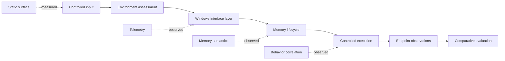

# ECHOSEEK

### Windows endpoint-security research, systems engineering, and controlled adversary emulation

<p>
  <a href="https://github.com/mohoamerakram-tech/ECHOSEEK/actions/workflows/public-safe-build.yml"></a>
  
  
  
  
  
  
  
  
  
</p>

ECHOSEEK is a privately held C++ research prototype developed during my cybersecurity engineering internship at ACKSEEK from 15 June to 1 September 2026. The project studied how endpoint-security products observe a custom Windows execution chain across static analysis, user-mode telemetry, native interfaces, memory semantics, and behavioral correlation.

This is a deliberately limited public engineering record. It contains enough technical material to evaluate the work, but it does not distribute the loader, payload, bypass implementation, infrastructure, or reproduction procedure.

## What is verifiable here

| Artifact | What it demonstrates |
|---|---|
| [Public-safe C++ subset](public-code/) | Compile-ready C++20, defensive PE-header parsing, entropy measurement, bounds checking, and testable data modelling |
| [Seven-layer technical model](TECHNICAL-NOTES.md) | The complete research surface, defensive signals considered, observed limits, and explicit publication boundary |
| [Sanitized lab video](assets/demo/echoseek-lab-validation-redacted.mp4) | Defender state, runtime memory transition, controlled Sliver session establishment, and final custom-scan result |
| [Validation notes](VALIDATION.md) | Environment, evidence chain, reported observations, and interpretation limits |
| [Evidence stills](#evidence-stills) | Privacy-safe snapshots extracted from the private engineering report |

## Engineering scope

The private prototype was organized into execution, native-interface, telemetry, resource, and build components. The public repository exposes only analytical and documentation code. The original implementation remains withheld because its components are operational when combined.



The diagram is architectural, not procedural. It intentionally omits algorithms, API sequences, constants, payload formats, and operational configuration.

## How the private prototype works

The private program is a staged Windows research prototype. In plain language, its data flow is:

1. **Recover configuration.** A small configuration value is decoded only when the program runs, reducing obvious readable strings in the file.
2. **Acquire the controlled test input.** Windows networking APIs parse the configured endpoint and receive the authorized lab artifact into a dynamically sized buffer.
3. **Prepare the in-memory representation.** The received bytes are transformed into the internal layout expected by the prototype. The exact wrapper and offsets are not public.
4. **Move through the memory lifecycle.** The private implementation separates the writable preparation phase from the executable view used later. This let the project study how memory type, permissions, and transition history affect detection.
5. **Transfer control.** Execution is scheduled on the current process using a Windows asynchronous-dispatch mechanism. The dispatch call sequence is withheld.
6. **Measure the result.** The run is observed from Windows, the controlled Sliver environment, and several endpoint-security products. The Bitdefender behavioral result showed that reducing isolated indicators did not erase the complete runtime story.

This description explains the engineering chain without providing the constants, native-call resolver, telemetry modification, memory-mapping sequence, or dispatch sequence required to reproduce it.

## Authentic fragments from the private source

The following excerpts are copied from the original project source. Only small, non-operational fragments are shown; adjacent loader logic, identifiers, secrets, and execution code are omitted.

### 1. In-place byte transformation

```cpp
void XorMemory(PVOID base, SIZE_T size, BYTE* key, DWORD keyLen) {
    BYTE* p = (BYTE*)base;
    for (SIZE_T i = 0; i < size; i++) {
        p[i] ^= key[i % keyLen];
    }
}
```

The function walks a byte range and combines each byte with a repeating key. Applying the same operation twice restores the original bytes. It demonstrates pointer arithmetic, bounded iteration, and in-place transformation; it is simple obfuscation, not cryptographic protection. The original key and the data passed to this helper are not published.

### 2. Windows URL decomposition

```cpp
URL_COMPONENTS urlComp;
ZeroMemory(&urlComp, sizeof(urlComp));
urlComp.dwStructSize = sizeof(urlComp);
urlComp.dwHostNameLength = (DWORD)-1;
urlComp.dwUrlPathLength = (DWORD)-1;
urlComp.dwExtraInfoLength = (DWORD)-1;
if (!WinHttpCrackUrl(wide_url, 0, 0, &urlComp)) {
    return 1;
}
```

Windows receives a fully initialized `URL_COMPONENTS` structure and returns views of the hostname, path, and extra information. Setting the component lengths to `-1` asks WinHTTP to calculate them. The actual endpoint, component copies, request construction, certificate settings, and transfer procedure are deliberately absent.

### 3. Checked geometric buffer growth

```cpp
if (totalBytes + bytesRead > capacity) {
    capacity *= 2;
    unsigned char* newPayload = (unsigned char*)realloc(payload, capacity);
    if (!newPayload) { free(payload); return 1; }
    payload = newPayload;
}
memcpy(payload + totalBytes, buffer, bytesRead);
totalBytes += bytesRead;
```

The receive buffer starts with reserved capacity and doubles only when the next block would exceed it. The temporary `realloc` result prevents the original allocation from being lost on failure. The final two lines append the new block and advance the logical length. The code that obtains the bytes and the code that consumes the completed buffer are not public.

These excerpts establish that the portfolio is backed by working Windows C++ while keeping the operational composition private. The separate [`public-code/`](public-code/) directory contains a safe program that reviewers can compile and execute.

## Seven layers evaluated

| Layer | Evaluation focus | Outcome in the documented lab |
|---:|---|---|
| 1 | Static artifact analysis | No alert in the captured Microsoft Defender scan |
| 2 | Reputation and heuristic surface | No alert in the documented default Windows 11 configuration |
| 3 | Environment and sandbox analysis | Controlled execution reached the intended runtime phase |
| 4 | Telemetry and API observation | User-mode visibility was reduced in the tested configuration |
| 5 | Native-call interception boundary | The prototype reached the intended native operations |
| 6 | Memory-region inspection | The tested memory-oriented checks did not identify the staged content |
| 7 | Behavioral correlation | Bitdefender Advanced Threat Defense detected the runtime behavior |

The final row is important. The project did not achieve universal endpoint-security evasion. Its principal technical finding was the boundary between spatial concealment and behavior-aware detection. The detailed model is in [TECHNICAL-NOTES.md](TECHNICAL-NOTES.md).

## Public-safe code

The code under [`public-code/`](public-code/) is intentionally small but real. It builds and runs independently:

```bash
cmake -S public-code -B public-code/build
cmake --build public-code/build
ctest --test-dir public-code/build --output-on-failure
```

It includes:

- bounds-checked PE signature and COFF-header inspection;
- Shannon entropy measurement for byte ranges;
- a typed model for recording observations across all seven research layers;
- a self-test using an in-memory synthetic PE header.

It does not include execution, injection, telemetry modification, native-call resolution, payload retrieval, encryption material, or command-and-control logic.

## Technology and test stack

| Technology | Role in the project |
|---|---|
| C++ and Windows SDK | Systems implementation, PE structures, Win32 and native-interface research |
| Windows 11 x64 | Isolated endpoint under evaluation |
| Kali Linux | Separate authorized lab infrastructure |
| VMware Workstation | Reproducible virtualized test boundary |
| [Sliver](https://github.com/BishopFox/sliver) | Authorized adversary-emulation framework used to validate the controlled end-to-end session |
| Microsoft Defender | Primary Windows endpoint-protection evaluation |
| Malwarebytes | Secondary real-time and heuristic evaluation |
| Bitdefender | Static, memory-oriented, and advanced behavioral evaluation |
| CMake and CTest | Build and verification of the public-safe analytical subset |

Product names and logos belong to their respective owners. Their appearance here identifies the test environment and does not imply endorsement.

## Lab video

[Watch or download the sanitized lab validation video](assets/demo/echoseek-lab-validation-redacted.mp4)

The 127-second H.264 recording is derived from the original test capture. It preserves the observable Defender and runtime transitions while removing audio and excluding public IP addresses, private addresses, ports, endpoint names, usernames, session identifiers, and transfer logs. The unredacted recording is not published.

## Validation summary

| Evaluation layer | Documented observation | Public evidence |
|---|---|---|
| Microsoft Defender custom scan | No threat reported in the captured lab snapshot | Screenshot and video |
| Windows Security after execution | Dashboard remained in a no-action-needed state in the captured run | Screenshot and video |
| Runtime observation | Expected host process remained active with the documented memory transition | Screenshot and video |
| End-to-end lab path | The controlled Sliver session reached its expected state | Redacted video; identifiers withheld |
| Malwarebytes | No alert in the tested configuration | Private report |
| Bitdefender static and memory layers | No alert in the tested configuration | Private report |
| Bitdefender advanced behavioral layer | Runtime behavior was detected | Reported as the main limitation |

These are time-bounded observations from a specific isolated environment, not claims about current product versions or universal bypass capability.

## Evidence stills

### Defender scan snapshot


### Windows Security after the documented run


### Runtime process observation


## Independent verification

A signed internship attestation and evaluation from ACKSEEK confirm successful completion of the internship and the ECHOSEEK project. The originals contain contact data, signatures, and company stamps, so they are available only for legitimate private academic or recruitment verification.

## Publication boundary

The following are not distributed:

- the original stager source, executable, payload, or build chain;
- telemetry modification or native-call implementation;
- memory-execution and thread-dispatch implementation;
- encrypted configuration, keys, addresses, or deployment instructions;
- the full report, unredacted video, and internship documents.

This repository is intended for portfolio review, defensive research discussion, and authorized academic evaluation. It is not a software release.

Copyright (c) 2026 Akram Moho Amer. No license is granted for the private implementation or omitted materials.
