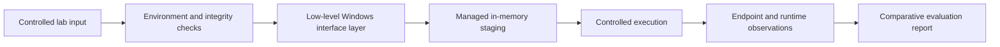
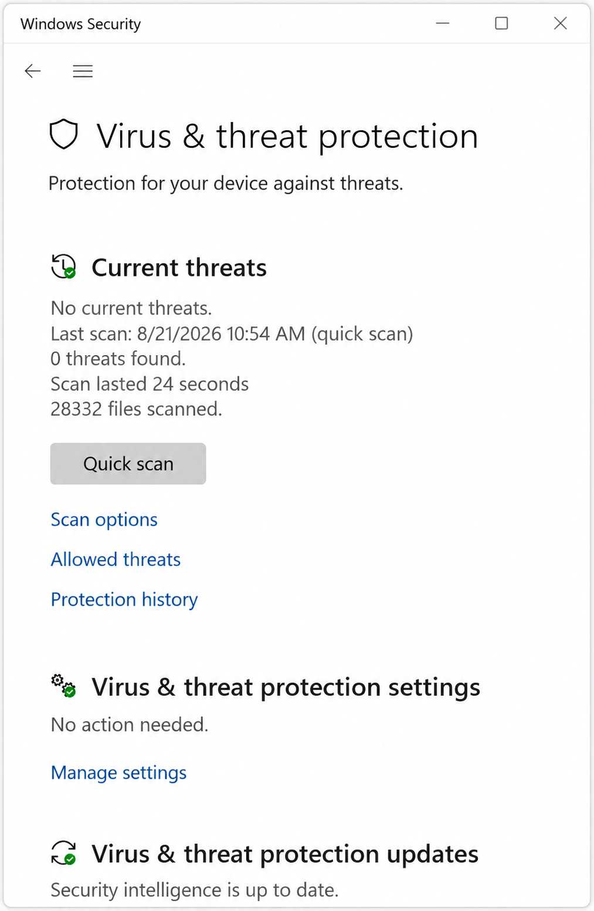
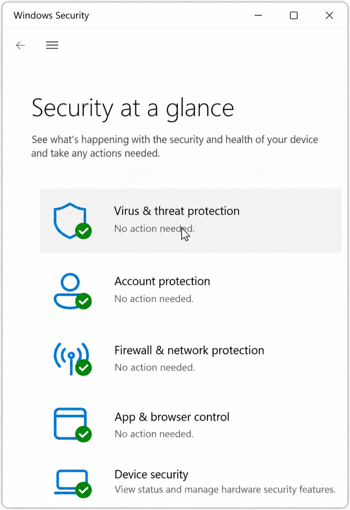
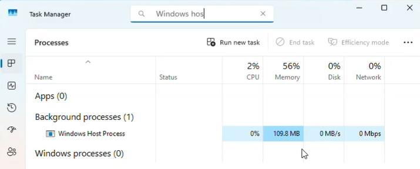

# ECHOSEEK - Windows Endpoint Security Research

> A public, non-operational portfolio showcase of a controlled security research project.

## Overview

ECHOSEEK was developed during my cybersecurity engineering internship at ACKSEEK (15 June - 1 September 2026) as part of my studies at ENSA El Jadida.

The project explored a difficult defensive-security question: how much visibility do modern Windows endpoint protections retain when a custom C++ research prototype uses low-level Windows mechanisms instead of conventional application patterns?

I designed and implemented a modular prototype, built an isolated Windows 11 / Linux test environment, and documented the work in a 57-page engineering report. The work required C++, Windows internals, PE-format analysis, native operating-system interfaces, x64 concepts, memory-lifecycle engineering, controlled command-and-control validation, and repeatable security testing.

## Public-release boundary

This repository intentionally contains **no runnable code** and **no operational material**. The following remain private:

- source code, binaries, payloads, build scripts, and cryptographic material;
- infrastructure addresses, server configuration, and deployment instructions;
- implementation-level evasion details;
- the full academic report and unredacted internship documents.

The goal is to demonstrate the engineering and research outcome without releasing a tool that could be reused outside an authorized lab.

## What I achieved

- Designed a modular Windows research prototype with separate execution, system-interface, telemetry, resource, and build components.
- Implemented approximately 400 lines of compact C++/header/build/support code, with no third-party runtime dependency in the Windows component.
- Built a repeatable evaluation workflow across static scanning, runtime observation, memory inspection, endpoint telemetry, and end-to-end lab connectivity.
- Evaluated the prototype against Microsoft Defender, Malwarebytes, and Bitdefender in controlled configurations.
- Identified and documented a meaningful boundary: Bitdefender's advanced behavioral layer detected the runtime behavior even when static and memory-oriented checks did not.
- Produced a 57-page bilingual technical report and received a strong internship evaluation for technical mastery, autonomy, rigor, and initiative.

## Sanitized architecture

This diagram shows component responsibilities only. It omits algorithms, call sequences, configuration, and implementation details.

## Validation summary

| Evaluation layer | Documented observation | Public evidence |
|---|---|---|
| Microsoft Defender custom scan | No threat reported in the captured lab snapshot | Redacted screenshot below |
| Windows Security after execution | Security dashboard remained in a no-action-needed state in the captured run | Redacted screenshot below |
| Runtime observation | Expected host process remained active in the lab with the documented memory footprint | Sanitized Task Manager capture below |
| End-to-end lab path | The staged workflow reached its expected controlled-session state | Verified in the private report; infrastructure evidence withheld |
| Malwarebytes | No alert in the tested configuration | Detailed evidence withheld |
| Bitdefender static/memory layers | No alert in the tested configuration | Detailed evidence withheld |
| Bitdefender advanced behavioral layer | Runtime behavior was detected | Reported openly as a project limitation |

These are time-bounded observations from a specific isolated test setup, not claims about current product versions or universal bypass capability. See [VALIDATION.md](VALIDATION.md) for the evidence policy and limitations.

## Sanitized evidence

The following images are privacy-preserving crops derived from the original report. Infrastructure identifiers and unrelated desktop context were removed; the security-status values were not intentionally changed.

### Defender scan snapshot

### Windows Security state after the documented run

### Runtime process observation

## Skills demonstrated

- C++ systems programming and modular design
- Windows internals and PE-format analysis
- Native API and x64 execution concepts
- Memory-management and telemetry research
- Isolated lab design and reproducible experimentation
- Endpoint-security evaluation and technical writing
- Responsible handling of dual-use research

## Independent verification

A signed internship attestation and evaluation from ACKSEEK confirm successful completion of the internship and the ECHOSEEK project. The originals include personal and company contact data, signatures, and stamps, so they are available only for private recruiter or academic verification.

## Responsible-use statement

This repository is documentation-only. It is intended for portfolio review, defensive research discussion, and authorized academic evaluation. Please do not request source code, binaries, payloads, or deployment guidance.

Copyright (c) 2026 Akram Moho Amer. No license is granted for the private implementation or omitted materials.
